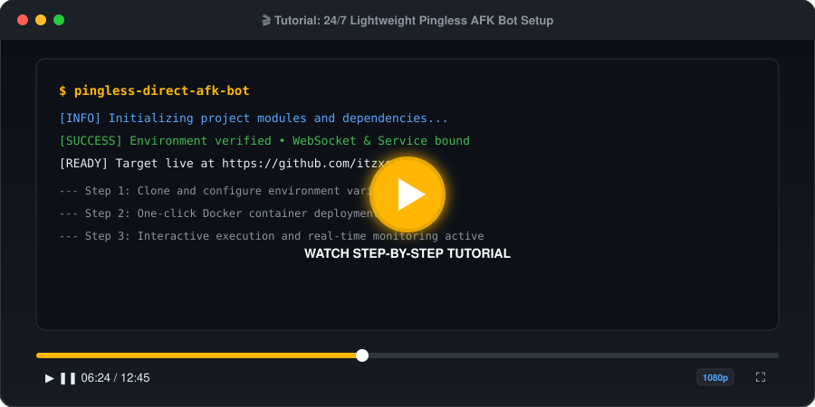
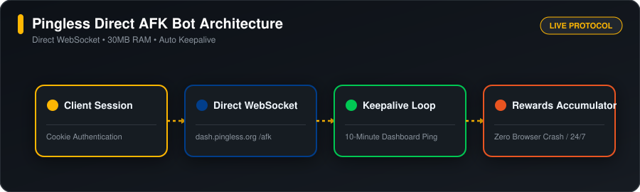

<h1 align="center">⚡ Pingless Direct AFK Bot</h1>

<p align="center">
  <a href="https://github.com/itzxsahil">
    
  </a>
</p>

<p align="center">
    
</p>

---

## 🎬 Video Tutorial & Interactive Walkthrough

<div align="center">
  <a href="https://www.youtube.com/results?search_query=itzxsahil+pingless+afk+bot">
    
  </a>
  <p><em>▶️ <strong>Interactive Project Tutorial</strong> — Click the player above to watch full setup guide &amp; demonstration!</em></p>
</div>

---

# 🚀 Overview

A high-efficiency, headless 24/7 AFK rewards bot for `dash.pingless.org`. By communicating directly via raw WebSockets, it eliminates the need for heavy Chrome or VNC containers.

---

## 🏗️ System Architecture & Data Flow

<div align="center">
  
</div>

<br>

AsyncIO client establishes persistent cookie-authenticated WebSockets directly with the Pingless backend, dispatching periodic heartbeats without any browser overhead.

---

# ✨ Features

✅ **Direct WebSocket Stream**: Eliminates browser crashes, canvas rendering overhead, and memory leaks.\n✅ **Ultra Low Footprint**: Consumes under 30MB RAM.\n✅ **Auto Keepalive**: Regularly pings `dash.pingless.org/dashboard` every 10 minutes to maintain persistent session state.

---

# 📦 Installation & Quickstart

### Cloud Deployment (Render / Railway)\nDeploy instantly using the bundled `Dockerfile` and `render.yaml`.\n\n### Local Run\n```bash\npip install -r requirements.txt\npython app.py\n```

---

# 👤 Author & Support
- Built with ❤️ by [@itzxsahil](https://github.com/itzxsahil)
- Star ⭐ this repository if you find it helpful!
